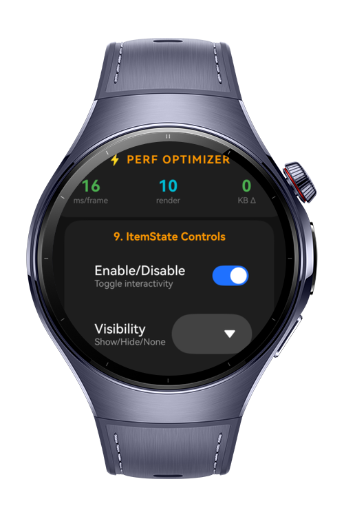
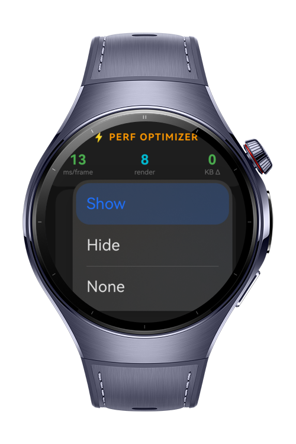
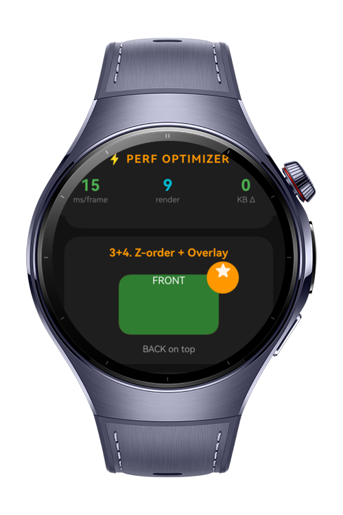

> **Note:** To access all shared projects, get information about environment setup, and view other guides, please visit [Explore-In-HMOS-Wearable Index](https://github.com/Explore-In-HMOS-Wearable/hmos-index).

# How To Build Visibility Render Control

**How To Build Visibility Render Control** is a HarmonyOS wearable codelab that demonstrates how to render user interface content only when it is visible on a round watch display.

This codelab teaches you how to use visibility-aware render logic, safe-area clipping, and efficient render node updates to keep the UI responsive while preserving battery life on wearable devices.

`What You’ll Learn`

- Use `RenderNode` and `RenderNodeController` to draw custom content on a circular wearable screen.
- Apply visibility checks and clipping masks to render only visible content.
- Manage render state updates with `setVisible` and conditional redraws.
- Build a visibility-driven watch face component for partial-ring and overlay states.

# Preview

<div>
  
  
  
</div>

# Use Cases

- **Optimize wearable graphics:** Avoid drawing off-screen content and reduce GPU work by rendering visible segments only.
- **Support circular screens:** Clip content to the round safe area and maintain consistent appearance on the Huawei wearable display.
- **Improve responsiveness:** Update animation and interactive rendering only when the component is visible.
- **Build custom status indicators:** Render segmented overlays, visibility-aware badges, and ring-based controls for glanceable UI.

# Tech Stack

- **Languages**: ArkTS, ArkUI
- **Frameworks**: HarmonyOS SDK 6.0.1 (API 21)
- **Tools**: DevEco Studio NEXT
- **Libraries**:
  - `@kit.ArkGraphics2D` (`drawing` module: `Canvas`, `Path`, `Paint`, `RenderNode`)
  - `@kit.ArkUI` (`NodeContainer`, `RenderNodeController`, `FrameNode`, `State`, `showToast`)
  - `@kit.ArkUI` (`text` module for readable labels and status text)

# Directory Structure

```text
entry/src/main/ets/
├── entryability/
│   └── EntryAbility.ets
├── entrybackupability/
│   └── EntryBackupAbility.ets
├── pages/
    └── Index.ets                    # Main page with demo UI and navigation
```

# Constraints and Restrictions

## Supported Devices

- Huawei Watch 5
- DevEco Studio Simulator

This codelab targets HarmonyOS wearable devices with a round display. The demo assumes a circular safe area and may need adaptation for square or rectangular wearables.

## Additional Notes

- The demo uses a circular safe area clip to ensure controls only appear inside the round wearable viewport.
- Visibility state is tracked independently from layout, so heavy draw operations are skipped when content is hidden.
- `RenderNode` updates are batched and throttled to prevent unnecessary redraws on the watch.
- The example is suitable for building battery-efficient wearables UI elements such as watch face rings, progress arcs, and status indicators.

# License

**How To Build Visibility Render Control** is distributed under the terms of the MIT License.
See the [LICENSE](/LICENSE) for more information.
